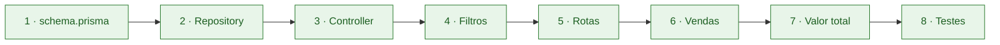

# 🌿 Relatório Desafio-Dev PTC `CITi`

### 🪴 Aspirante: `Breno Alves Chagas Rabêlo`

[🌱 Introdução](#introducao) &nbsp;•&nbsp;
[✅ O que foi feito?](#o-que-foi-feito) &nbsp;•&nbsp;
[🛠️ Como foi feito?](#como-foi-feito) &nbsp;•&nbsp;
[🧗 Dificuldades](#dificuldades) &nbsp;•&nbsp;
[🤖 Uso de IA](#uso-de-ia)

---

## 🌱 00 - Introdução

O presente relatório tem como objetivo descrever o trabalho feito durante o desafio e também descrever um pouco da experiência do aspirante durante o desenvolvimento do projeto.

> [!IMPORTANT]
> De antemão, gostaria de falar que esse desafio tem grandes chances de ser o meu desafio favorito durante todo o PTC. Estou no segundo período de Ciência da Computação no CIn e esta foi a primeira vez que me senti como um programador de verdade, produzindo algo útil e com aplicabilidade no mercado. Sem dúvidas, foi uma experiência muito legal e engrandecedora, gostaria de prestar meus sinceros agradecimentos ao time de Dev e à Equipe do PTC por terem proporcionado isso. 💚

---

## ✅ 01 - O que foi feito?

### 🛣️ Rotas

Foram implementadas as sete rotas pedidas: cadastro, listagem com filtros de luminosidade e `petFriendly` (sozinhos ou combinados), busca por id, edição parcial, remoção, venda e valor total do estoque.

### ⭐ Bônus

Além disso, como funcionalidades bônus foi criada uma filtragem por nome capaz de ignorar a diferenciação de letras maiúsculas/minúsculas, ordenação dos itens por preço ou nome e a rota de plantas esgotadas, visando facilitar a reposição do estoque. Como conteúdo extra que poderia ter sido implementado, penso na criação de um histórico de vendas, visando controlar o fluxo de saída de plantas e também um sistema de carrinho para que possam ser compradas várias plantas de uma única vez.

### 📏 Regras

Em relação às regras, uma regra de cadastro é que todos os campos são obrigatórios, ou seja, um único campo ausente invalida todo o cadastro, isso sem contar a verificação de tipos de cada campo cadastrado, tornando o sistema mais confiável.

Tirando a parte da obrigatoriedade de todos os campos, a edição de dados cadastrados está submetida às mesmas regras do cadastro e campos sensíveis como o id não podem ser alterados.

Outra importante regra criada é a verificação de venda: para que uma venda ocorra é necessário que o número cadastrado seja maior que 0 e menor ou igual ao estoque da planta, isso garante que incoerências como estoque negativo ou vendas não positivas não ocorram.

---

## 🛠️ 02 - Como foi feito?

A ordem seguida foi aquela sugerida no enunciado:

#### 🧱 1. Primeiro configurei o `schema.prisma` criando o model `Planta`;

Criei o enum `Luminosidade` com os três valores possíveis e o model `Planta` com todos os campos do enunciado, usando id com autoincrement e copiando o `createdAt` e o `updatedAt` do model `User`. Depois rodei o `yarn migration` e conferi no Prisma Studio se a tabela tinha sido criada.

#### 🗄️ 2. Depois editei o `PlantaRepository` criando as funções pedidas;

Seguindo o modelo do `UserRepository`, criei uma função para cada consulta ao banco (`createPlanta`, `findAllPlantas`, `findPlantaById`, `updatePlanta` e `deletePlanta`). Diferente do usuário, as funções recebem o id como número, sendo o repository a única camada que acessa o Prisma.

#### 🎛️ 3. Criei o arquivo `PlantaController` onde criei os handlers das plantas e suas respectivas validações;

Criei os handlers de cadastro, listagem, busca, edição e remoção, todos dentro de um `try/catch` que responde `500` em caso de erro inesperado. Para as validações, fiz uma única função que serve tanto para o cadastro quanto para a edição, e uma função auxiliar que converte o id da rota para número e verifica se é válido.

#### 🔍 4. Adicionei os filtros de luminosidade e `petFriendly`;

No handler de listagem, passei a ler os filtros do `req.query`, validando cada um e retornando `400` para valores inválidos. Além disso, fiz a lógica do `petFriendly` com três estados (não enviado, `true` e `false`), assim, a ausência de filtro não é confundida com `false`.

#### 🛣️ 5. Criei as rotas das plantas no arquivo `routes.ts`;

Registrei cada rota ligada ao seu handler, seguindo o padrão das rotas de usuário. Coloquei as rotas fixas antes das rotas com `:id`, para que o Express não tratasse palavras como "estoque" como se fossem um id.

#### 🛒 6. Criei o sistema de vendas, já incluso com suas rotas e validações no controller;

O handler de venda valida o id e a quantidade, busca a planta (`404` se não existir) e confere se há estoque suficiente (`400` se não houver). Para evitar que duas vendas simultâneas deixassem o estoque negativo, a conferência e o desconto do estoque são feitos em uma única operação no banco.

#### 💰 7. Implementação do sistema de valor total do estoque;

Criei uma consulta que busca apenas o preço e o estoque de cada planta e, no controller, somei preço × estoque planta por planta, junto com o total de vasos. Com a loja vazia, a rota retorna os dois valores zerados.

#### 🧪 8. Realizei os testes pedidos usando o Thunder Client;

Inseri os dados manualmente no banco e fui testando cada requisição para ver se o código e o comportamento recebido eram iguais ao esperado. Tudo passou sem problemas. Além dos testes manuais, também usei o arquivo `testar-api.sh`, gerado por inteligência artificial, que possui uma bateria de testes automatizados

> [!NOTE]
> Obs: a ordem dos passos 4 e 5 está invertidas em relação ao enunciado.

> [!TIP]
> Após fazer a parte obrigatória do desafio, prossegui com a implementação de duas features adicionais: busca por nome e ordenação de itens por preço; sistema de exibição de plantas esgotadas. Ambas as features foram testadas e aprovadas.

### 🗂️ Organização

Na organização, mantive as mesmas camadas do projeto:

### 🗂️ Organização

Na organização, mantive as mesmas camadas do projeto:

| Camada | Papel |
|:--:|---|
| 🛣️ **routes.ts** | O `routes.ts` liga cada método e URL à função certa do controller, sem nenhuma lógica; |
| 🎛️ **Controller** | O Controller é onde o sistema administra as requisições: lê os dados, valida, aplica as regras de negócio e escolhe o status da resposta; |
| 🗄️ **Repository** | O Repository é a única camada que conversa com o banco, com uma função para cada consulta; |
| 🔺 **Prisma** | Na pasta Prisma está o database do sistema, armazenando as informações cadastradas. |

Decidi seguir a ordem e a organização apresentadas, pois achei que esse seria o caminho mais linear. Em nenhum momento do desafio senti vontade de alterar algo em relação a isso. Em relaçao a ordem dos passos 4 e 5, eles estão invertidos porque durante o desenvolvimento, acabei "atropelando" o passo 4 do guia de construção e pulando direto para o 5, porém depois percebi que havia pulado uma parte e voltei para refazer.

---

## 🧗 03 - Principais dificuldades

- 📘 Acho que uma das maiores dificuldades foi aprender uma nova linguagem (pelo menos um pouco dela) em cerca de 1 semana. Apesar disso, eu gostei bastante de TypeScript e achei ele parecido com uma mistura entre Python e C++.

- ⚡ Outra parte que tive dificuldade foi na realização dos testes com ThunderClient, como nunca tinha interagido com o programa, demorei um pouco até entender como a interface dele funcionava, mas com algumas pesquisas consegui aprender a usá-lo.

---

## 🤖 04 O Uso de IA

Para me ajudar nesse desafio, criei um projeto no Claude e pedi para ele gerar um guia de estudos baseado no arquivo do desafio para que eu pudesse ser capaz de executar as etapas pedidas. O prompt usado foi:

> 💬 *"Quero que você leia esse documento e produza um guia didático de execução do mesmo. Tenha em mente que apesar de eu ser programador junior, não sei absolutamente nada sobre Node.js, TypeScript, Express, Prisma, PostgreeSQ e Docker, então seu guia tem que ir desde o nível mais raso (como instalar, configurar e integrar com o vs code, se for possível uma integração, cada uma das ferramentas citadas acima) até conceitos mais avançados que me permitam implementar cada etapa solicitada por mim mesmo. Tenha em mente que não quero ser apenas um executor de tarefas, mas quero entender de fato o que estou codando e sair confiante após a resolução do desafio. Obs: por recomendação dos líderes do desafio, estou usando a extensão Thunder Client do VS code, mas a única coisa que fiz foi instalá-la, não sei para que serve e muito menos como usá-la. Faça seus guias de instalação e configuração baseando-se no sistema operacional Linux Ubuntu 26.04 LTS"*

O guia gerado possuía 43 páginas abordando guias de instalação, explicação dos conceitos solicitados e testes sugeridos. Li todas as páginas e consegui implementar todos os códigos manualmente. O Claude também foi usado como monitor particular, então sempre que eu tinha dúvida sobre algo (muitas vezes sobre os conceitos do próprio guia) eu recorria a ele para me ajudar, sempre seguindo a mesma lógica de entender o conceito e tentar implementar por mim mesmo.

> [!IMPORTANT]
> Por fim, além dos códigos, este relatório também foi feito à mão, com ajudas pontuais da IA para relembrar alguns conceitos. Foi utilizado o Claude para fazer a reestilização do relatório em um formato mais colorido e atraente visualmente, mas os textos escritos por mim permaneceram inalterados.

---

🌿 &nbsp; 🪴 &nbsp; 🌵 &nbsp; 🌱 &nbsp; 🍃

